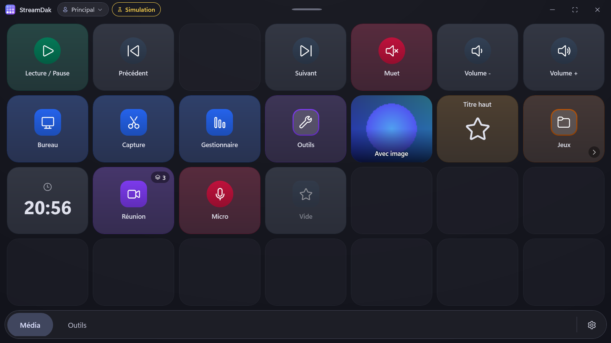
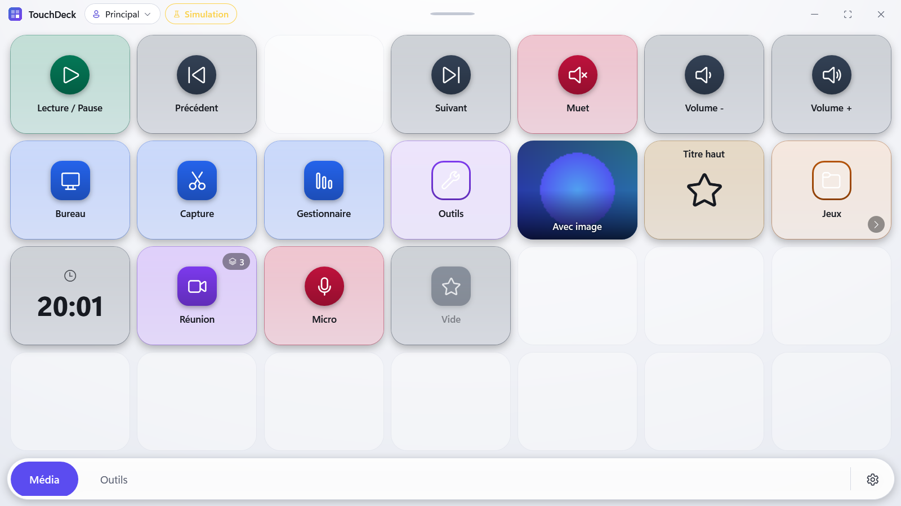
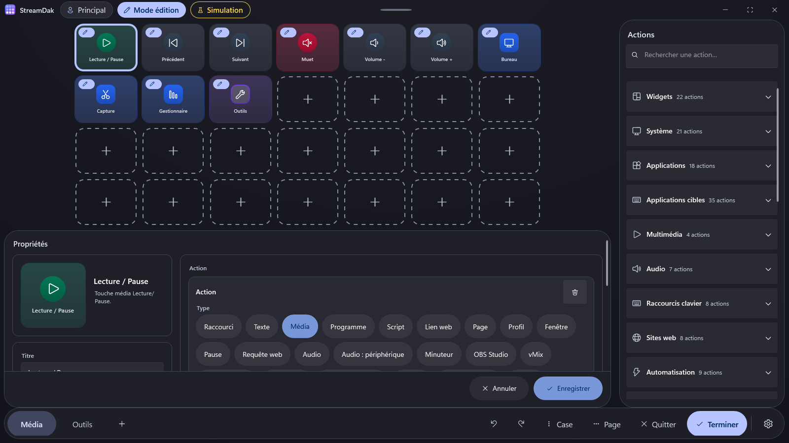
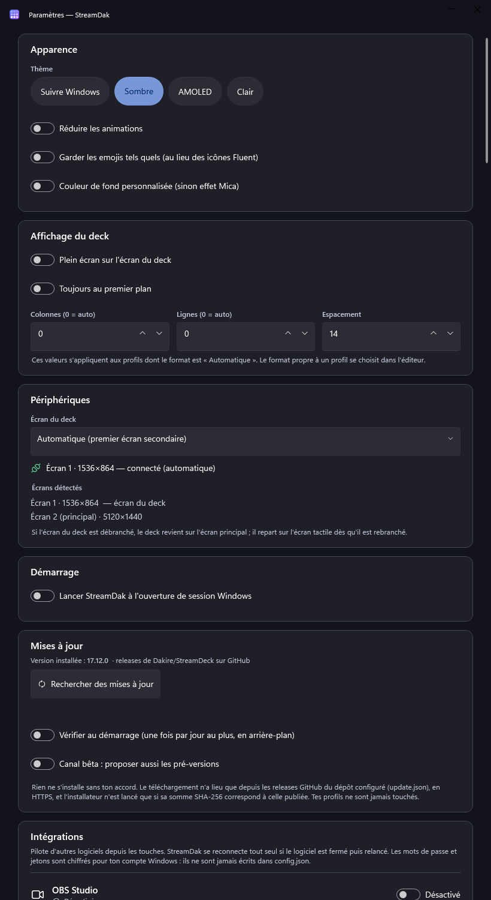

# TouchDeck

Tableau de bord de raccourcis façon Stream Deck pour Windows, pensé pour un écran tactile secondaire.
Usage visé : perso, pro IT et gaming.

Chaque bouton lance une ou plusieurs actions : raccourci clavier, saisie de texte, touche média,
programme, script, URL, requête web (webhook), micro et volume, minuteur, changement de page ou de profil, délai,
mise au premier plan d'une fenêtre. Un bouton peut aussi afficher l'heure ou la date.



| Thème clair | Éditeur | Paramètres |
|---|---|---|
|  |  |  |

*Captures rendues hors écran par le harnais de tests, en mode simulation (d'où le badge « Simulation »).*

## Documentation

| Document | Contenu |
|---|---|
| [Architecture](docs/ARCHITECTURE.md) | Couches, exécution d'un bouton, mise à jour de la grille, choix de WPF (diagrammes) |
| [Format de configuration](docs/configuration.md) | `config.json` en détail, cycle de vie, migrations, exemple |
| [Développement](docs/DEVELOPMENT.md) | Prérequis, commandes, tests, vérifications manuelles, jetons de design |
| [Contribuer](CONTRIBUTING.md) | Conventions de code, branches, commits, tests |
| [Décisions d'architecture](docs/adr/README.md) | Pourquoi WPF, le document unique, la plateforme abstraite… |
| [Journal des modifications](CHANGELOG.md) | Ce qui a changé, version par version |
| [Parité avec Stream Deck](docs/FEATURE_PARITY.md), [rétro-ingénierie](docs/REVERSE_ENGINEERING.md) | Fonctions couvertes et écarts |
| [Étude des intégrations](docs/integrations-research.md) | OBS, Twitch, Discord, Hue… : faisabilité et ordre de réalisation |
| [Bilan du nettoyage](docs/cleanup-report.md) | Corrections, mesures avant / après, risques restants (phase 1) |
| [Bilan de l'architecture](docs/phase2-report.md) | Trois projets, injection de dépendances, Serilog, gestionnaires d'action (phase 2) |
| [Bilan des intégrations, plugins et API](docs/phase8-9-report.md) | Ce qui est fait, mesures, écarts avec la demande, décisions à prendre (phases 8 et 9) |
| [Intégrations](docs/integrations/) | OBS, vMix, Elgato, Hue, Windows, Teams, X-Plane, Twitch, ClickUp, Notion, monday, raccourcis d'applications |
| [Plugins](docs/plugins.md), [API locale](docs/local-api.md) | Ajouter une intégration sans modifier TouchDeck ; piloter le deck depuis un script |

## Fonctionnalités

**Le deck (écran tactile)**

- Grille de boutons adaptative (nombre de cases selon la résolution) ou format fixe par profil, avec sous-pages automatiques ;
  touches aux proportions bornées, grille centrée, emplacements libres dessinés « éteints ».
- Touches modernes : corps teinté par la couleur du bouton, couleur pleine sur une pastille d'icône ; variantes média (pastille ronde),
  navigation (contour + chevron), affichage (heure ou minuteur en grand), image plein cadre ; badge du nombre d'étapes.
- Retour d'exécution sur la touche : anneau si l'action dure, coche si elle réussit, alerte et message si elle échoue (étape en cause).
- Barre du haut : profil actif (toucher pour en changer), badges *Mode édition* et *Simulation*. Dock du bas : pages, sous-pages, menu.
- Profils, pages en onglets, dossiers et sous-dossiers ; pages masquées accessibles par une action `page`.
- Fenêtre qui ne prend pas le focus : les raccourcis arrivent à l'application active.
- Plein écran sur l'écran secondaire ou mode fenêtre, sans masquer la barre des tâches (le deck occupe la zone de travail) ; le deck suit le branchement et le débranchement de l'écran, et se cale exactement même entre écrans de densités différentes.
- Profil associé à une application : il s'affiche seul quand le programme est au premier plan.
- Mode édition tactile (menu ⚙ › *Modifier au toucher*) : toucher un bouton ouvre l'éditeur dessus.
- Thème **Material Design 3** : palettes tonales (sombre, AMOLED, clair) générées depuis une couleur source, surfaces à élévation tonale, sans ombre portée.
- **Création rapide**, sans ouvrir l'éditeur : **clic droit** ou **appui long** (environ 0,55 s, doigt immobile) sur une **case vide**
  ouvre un menu : *Nouveau bouton…* (panneau où l'on tape un nom d'action, « chrome » ou « vol », puis Entrée), *Parcourir les actions*
  (catégories, au toucher), des **modèles en un clic** (raccourci clavier, lancer une application, ouvrir un site, volume / muet,
  média, script, dossier, page), *Coller* et *Éditeur complet…*. Chaque création est une seule modification annulable, avec un bouton
  *Annuler* dans le bandeau d'état. Une page ou un dossier vide propose *Ajouter un bouton* sur sa première case.
- **Glisser-déposer** d'un fichier, d'un raccourci `.lnk`, d'un exécutable, d'un dossier, d'un raccourci Internet ou d'une adresse
  web sur une case vide : le bouton *Lancer* ou *Ouvrir* est créé sans dialogue, avec le bon titre et l'icône de l'application.
  Plusieurs éléments remplissent les cases libres suivantes (douze au plus), en une seule annulation.
- Sur un **bouton**, le même geste ouvre son menu : *Modifier…* (éditeur rapide : le titre est sélectionné), *Dupliquer* (dans la
  prochaine case libre), *Copier*, *Couper*, *Supprimer*, *Éditeur complet…*. L'appui long n'exécute pas l'action ; un glissement du
  doigt l'annule ; le toucher ne déplace jamais le curseur. Un bouton qui échoue propose *Modifier* dans le bandeau d'état.

**L'éditeur** (menu ⚙ › *Ouvrir l'éditeur*, ou `TouchDeck.exe --edit`)

- Trois panneaux inspirés d'Elgato Stream Deck : catalogue d'actions, grille du deck, propriétés du bouton.
- Catalogue : recherche instantanée, 8 catégories repliables, favoris, actions récentes, glisser vers une case.
- Grille fidèle au deck : sélection, case vide, glisser-déposer (déplacer, échanger, copier avec Ctrl, ranger dans un dossier,
  envoyer vers une autre page), formats 3×2, 5×3, 6×3, 5×4, 8×4 ou automatique.
- Propriétés : aperçu, titre, étapes multiples (ajout, ordre, suppression), validation en direct ; position du titre, icône Fluent /
  emoji / texte, image importée et couleurs sont dans un bloc *Apparence* replié par défaut, avec réinitialisation de l'apparence.
  La saisie (titre, icône, couleurs, valeur des étapes) est un brouillon : l'aperçu suit chaque caractère, mais la configuration
  n'est écrite qu'à la validation (Entrée, changement de champ ou de case, fermeture), en une seule modification annulable.
  Échap abandonne la saisie en cours. Les boutons *Annuler* (retour à l'état de la case à l'ouverture, ou case vide si le bouton
  vient d'y être créé) et *Enregistrer* sont en bas du panneau ; ouvert par clic droit ou appui long, l'éditeur se referme avec eux.
- Menus contextuels (clic droit, appui long, touche Menu) sur les cases, profils, pages et catalogue.
- Annuler / rétablir (100 niveaux), presse-papiers interne, notifications avec bouton *Annuler*.
- Profils : créer, renommer, dupliquer, supprimer, exporter / importer (`.touchdeck`), définir comme profil actif,
  associer à une application.
- Paramètres : thème, animations, icônes, fond, plein écran, premier plan, grille, écran du deck, lancement avec Windows,
  sauvegardes (export, import, restauration), raccourcis.

Cliquer un bouton dans l'éditeur ne l'exécute jamais.

**Intégrations** (Paramètres › Intégrations, chacune activée à la demande)

- Connecteurs livrés : **OBS Studio**, **vMix**, **lampes Elgato**, **Philips Hue**, **Système Windows** (processeur, mémoire, média en cours,
  donc Spotify sans compte), **Microsoft Teams**, **X-Plane 12**, **Twitch**, **ClickUp**, **Notion**, **monday.com**. 35 boutons de
  raccourcis prêts à l'emploi pour Zoom, Teams, Discord, Premiere, Photoshop, DaVinci, Blender, Outlook, Word, Excel et Star Citizen.
- Les commandes sont des actions du catalogue (une catégorie par intégration). L'état s'affiche sur les touches : voyant plein / vide
  (micro coupé, direct en cours…) et valeurs dans les titres, par exemple `Scène : {obs.scene}`, `CPU {sys.cpu} %`.
- Une intégration en panne ne gêne jamais le deck : reconnexion automatique (2, 4, 8… 60 s), état lisible dans les paramètres.
- Mots de passe et jetons chiffrés pour ton compte Windows (`secrets.dat`), jamais dans `config.json` ni dans le journal.
- Modèles de profils (réunions, streaming OBS, montage, simulation de vol, poste de travail), API locale par canal nommé, plugins
  posés dans `plugins\`, instance unique et icône de la zone de notification.

### Raccourcis de l'éditeur

| Raccourci | Effet |
|---|---|
| `Ctrl+Z`, `Ctrl+Y` / `Ctrl+Maj+Z` | Annuler, rétablir |
| `Ctrl+C`, `Ctrl+X`, `Ctrl+V`, `Ctrl+D` | Copier, couper, coller, dupliquer la case sélectionnée |
| `Suppr` | Supprimer le bouton |
| `F2` | Modifier le titre |
| `Entrée` | Ouvrir le dossier / configurer le bouton |
| `Retour arrière` | Remonter d'un dossier |
| `Alt+flèches` | Déplacer le bouton (échange avec la voisine) |
| `Ctrl+F` | Chercher dans le catalogue |
| `Maj+F10`, touche Menu | Menu contextuel |
| `Échap` | Fermer un menu, annuler un glisser-déposer |

Ces raccourcis ne s'appliquent jamais pendant la saisie dans un champ de texte.

## Prérequis

- Windows 10 ou 11 (Windows 11 recommandé : effet Mica dans l'éditeur et les paramètres ; le deck a son propre fond, opaque)
- Runtime Desktop .NET 10 pour exécuter
- [.NET 10 SDK](https://dotnet.microsoft.com/download/dotnet/9.0) pour compiler, runtime Desktop pour exécuter

## Démarrage rapide

```powershell
dotnet run -c Release
dotnet run -c Release -- --simulate  # essai sans risque : les actions sont affichées, rien n'est envoyé au système
dotnet run -c Release -- --edit      # ouvre aussi l'éditeur
dotnet build -c Release              # aucun avertissement toléré (analyseurs, style, documentation XML)
dotnet test tests/TouchDeck.Tests    # tests automatisés (l'interface est rendue hors écran)
```

Pour essayer sans toucher à votre configuration : `$env:TOUCHDECK_DATA_DIR = "$env:TEMP\touchdeck-essai"`.

Pour produire l'exécutable :

```powershell
dotnet publish -c Release -r win-x64 --self-contained false
```

La publication précompile le code (ReadyToRun) : démarrage environ 80 ms plus court (mesuré : 705 à 650 ms). `dotnet run` n'en profite pas.

## Configuration

Dossier : `%APPDATA%\TouchDeck` (ou le dossier de la variable d'environnement `TOUCHDECK_DATA_DIR`).

| Élément | Rôle |
|---|---|
| `config.json` | Configuration, créée au premier lancement. Surveillée : toute modification enregistrée est appliquée sans redémarrer. |
| `Icons\` | Images des boutons (PNG, nommées d'après leur contenu). |
| `Backups\` | Sauvegardes automatiques (15 conservées). |
| `config.v1.backup.json` | Copie intacte de l'ancien fichier, faite une seule fois lors du passage aux profils. |
| `touchdeck.log` | Journal : démarrage (avec le temps de chaque étape), erreurs, actions en échec, changements d'écran. 1 Mo par fichier, 3 fichiers conservés (`touchdeck.log`, `touchdeck_001.log`…). |

L'éditeur enregistre à chaque modification validée (écriture atomique : un arrêt en cours d'écriture ne corrompt pas le fichier).
Un fichier `config.json` invalide n'est jamais écrasé sans copie : il est conservé sous `config.invalide-<date>.json`.

Le format complet (modèle, cycle de vie, migrations, exemple) est décrit dans [docs/configuration.md](docs/configuration.md).
Les tableaux ci-dessous en donnent l'essentiel.

### Clés de `config.json`

| Clé | Rôle | Défaut |
|---|---|---|
| `Version` | Version du format (`2`) | `2` |
| `Monitor` | Index de l'écran, `-1` = premier écran secondaire | `-1` |
| `MonitorDevice` | Identifiant Windows de l'écran choisi (`\\.\DISPLAY2`), prioritaire sur `Monitor` dont l'index change au rebranchement ; facultatif | absent |
| `Fullscreen` | Plein écran sur l'écran cible | `true` |
| `AlwaysOnTop` | Reste au-dessus des autres fenêtres | `false` |
| `Columns` / `Rows` | Taille de la grille pour les profils en format automatique, `0` = selon l'écran | `0` |
| `Spacing` | Espacement entre boutons (DIP) | `14` |
| `Background` | Couleur de fond ; la valeur par défaut affiche le fond nuancé du thème | `#0E1015` |
| `Theme` | `system` (suit Windows), `dark` ou `light` | `dark` à la création, sinon inchangé |
| `IconStyle` | `fluent` : emojis connus affichés en icônes Fluent ; `emoji` : tels quels | `fluent` |
| `StartWithWindows` | Reflet du lancement à l'ouverture de session (le registre fait foi) | |
| `ReduceMotion` | Supprime les animations | `false` |
| `ActiveProfile` | Profil affiché sur le deck | premier profil |
| `Favorites`, `Recents` | Identifiants d'actions du catalogue | `[]` |
| `Profiles` | Liste de profils : `Name`, `Columns`, `Rows`, `AppMatch`, `Pages` | |
| `Integrations` | Par identifiant d'intégration : `Enabled` et `Values` (adresse, port…). Les secrets n'y sont jamais : `secrets.dat` | absent |

Un profil contient des `Pages` ; une page, des `Buttons` dans l'ordre de la grille. Un bouton :

| Clé | Rôle |
|---|---|
| `Label`, `Icon`, `Color`, `Actions` | Titre, icône (nom Fluent, emoji ou texte), couleur, étapes |
| `HideTitle`, `TitlePosition` | Masquer le titre ; `top` / `middle` / `bottom` (absent : sous l'icône) |
| `TextColor` | Couleur du texte et de l'icône |
| `ImagePath`, `ImageFit` | Image importée (nom dans `Icons\`), `cover` ou `contain` |
| `IsFolder`, `Children` | Dossier et son contenu |
| `Blank` | Case vide qui garde la position de ses voisines |

**Ancien format** : un `config.json` sans `Version`, avec `Pages` à la racine, se charge tel quel. Il est converti en un profil
« Principal » et réécrit au nouveau format, après copie dans `config.v1.backup.json`. Aucune clé n'est supprimée ni renommée,
sauf `Pages` qui descend dans `Profiles[].Pages`. Les nouvelles clés sont facultatives.

### Types d'actions

| `Type` | `Value` | `Args` |
|---|---|---|
| `hotkey` | Combinaison, ex. `ctrl+shift+esc` | |
| `text` | Texte à saisir | |
| `media` | `playpause`, `prev`, `next`, `stop`, `mute`, `voldown`, `volup` | |
| `launch` | Programme à lancer | Arguments |
| `script` | Fichier `.ps1`, `.bat`, `.cmd` ou commande PowerShell | Arguments |
| `url` | Adresse à ouvrir (`javascript:`, `vbscript:`, `data:` et `file:` sont refusés) | |
| `page` | Nom de page, `home` ou `back` | |
| `profile` | Nom du profil à afficher | |
| `delay` | Durée en millisecondes | |
| `focus` | Titre ou processus de la fenêtre | Programme à lancer si absente |
| `http` | Adresse `http://` ou `https://` (requête GET) | Corps facultatif : requête POST, en JSON s'il commence par `{` ou `[` |
| `audio` | `mic-toggle`, `mic-mute`, `mic-unmute`, `out-toggle`, `volume` | Niveau 0 à 100 pour `volume` |
| `timer` | Durée en secondes ; toucher à nouveau arrête le minuteur | |

Chaque étape a un délai maximal (5 s pour le clavier, 10 s pour `http` et `focus`, 15 s pour lancer un programme ;
aucun pour `delay` et `timer`). La première étape en échec arrête la séquence, et la touche affiche une alerte.

**Titres dynamiques** : `{time}` (heure), `{date}` (date), `{time:HH:mm:ss}`, `{date:dddd d MMMM}` (formats .NET, en français) et
`{timer}` (temps restant du minuteur du bouton). Le titre enregistré ne change pas ; seul l'affichage est calculé.
Un bouton sans action dont le titre contient `{time}` ou `{date}` sert d'horloge.

## Import et export

- **Profil** : éditeur › menu du profil › *Exporter…* / *Importer…*.
- **Configuration complète** : Paramètres › Sauvegardes.

Le format `.touchdeck` est une archive zip (`profile.json` ou `config.json`, `icons/*.png`). L'import vérifie la taille,
le nombre d'éléments, les types d'actions et les noms d'images, ne lit jamais de chemin libre dans l'archive, demande
confirmation (en signalant les actions qui lancent des programmes ou des scripts), fait une sauvegarde puis peut être annulé.

## Structure du dépôt

| Dossier / fichier | Contenu |
|---|---|
| `Core/` (projet `TouchDeck.Core`, `net10.0`) | Logique sans WPF ni Windows : `Models`, `DeckDocument` (opérations, historique), `ConfigStore`, `ConfigNormalizer` (migration), `ActionTypes` (clés du format), `ActionCatalog`, `QuickCreate` (modèles, suggestions), `DroppedItem` (éléments déposés), `ActionValidator`, `HotkeySyntax`, `Displays`, `LabelTemplate`, `Countdowns`, `Log` (façade) |
| `Core/Actions/` | Moteur d'actions (`ActionEngine`, `ActionRegistry`), un gestionnaire par type dans `Handlers/`, interfaces de plateforme, plateforme simulée |
| `Platform/Windows/` (projet `TouchDeck.Platform.Windows`) | Implémentation Windows des interfaces de plateforme : `SendInput`, fenêtres Win32, Core Audio, registre. Seul `WindowsPlatform` est public |
| `Core/Integrations/`, `Core/Api/`, `Core/Plugins/` | Cadre d'intégrations (`IIntegration`, `IntegrationManager`, bases HTTP et REST), API locale, chargeur de plugins |
| `Integrations/<Nom>/` | Un projet par connecteur : Obs, Vmix, ElgatoLight, Hue, WindowsSystem, XPlane, Teams, Twitch, ClickUp, Notion, Monday |
| `samples/HelloPlugin` | Exemple de plugin |
| `Services/` | `AppHost` (racine de composition, journal Serilog), `ConfigPersistence` (sauvegarde auto, rechargement à chaud), `AppearanceService`, `AppWindows`, `DisplayService`, `IconStore`, `DropPayload` (lecture d'un glisser-déposer), `ProfilePackage`, `TransferService`, `Notifier`, `Motion` |
| `ViewModels/` | `MainViewModel` (deck ; menu des cases et glisser-déposer en classes partielles), `EditorViewModel`, `PropertiesViewModel`, `CatalogViewModel`, `QuickCreateViewModel`, `SettingsViewModel`, `MenuSpec`, `CatalogMenu` |
| `Controls/` | `TileFace` (rendu d'un bouton), `ContextMenuFactory`, `PromptWindow`, `QuickCreateWindow` (panneau de création rapide), `PropertiesPanel` (panneau de propriétés de l'éditeur) |
| `MainWindow.xaml(.cs)` | Deck ; code-behind limité à Win32 et au placement multi-écran |
| `EditorWindow.xaml(.cs)`, `SettingsWindow.xaml(.cs)` | Éditeur et paramètres (dialogues, focus, clavier, glisser-déposer) |
| `Theme.cs`, `Core/MaterialColor.cs`, `IconCatalog.cs`, `App.xaml` | Palettes Material Design 3 générées depuis une couleur source (contrastes vérifiés), icônes, styles |
| `docs/` | Architecture, configuration, développement, décisions (`adr/`), parité fonctionnelle, intégrations, bilans |
| `tests/TouchDeck.Tests` | Tests xUnit : logique, migration, import, contrastes, navigation du deck, robustesse, composition (conteneur), architecture (frontières entre projets), rendu hors écran des fenêtres, mesures de performance (facultatives) |
| `Directory.Build.props`, `.editorconfig` | Analyseurs, style vérifié à la compilation, avertissements bloquants, documentation XML obligatoire |

## Accessibilité

Contraste des textes et des anneaux de focus vérifié par tests (WCAG 2.2 AA) en thèmes clair, sombre et AMOLED ; un test exige un nom accessible pour chaque contrôle interactif du deck, de l'éditeur, des paramètres et du panneau rapide ; focus clavier visible ;
état jamais porté par la couleur seule (icône + texte pour les erreurs, coche sur les couleurs, bordure + anneau pour la sélection) ;
noms accessibles et annonces polies (`LiveSetting`) pour les notifications et erreurs ; cibles de 48 px minimum ;
animations coupées par le réglage TouchDeck ou celui de Windows.

## Limites connues

- Pas de périphérique matériel : TouchDeck n'est pas un pilote de Stream Deck Elgato. Le « périphérique » est l'écran du deck.
- Plugins : seulement du code local posé par l'utilisateur dans `plugins\` (jamais téléchargé), exécuté avec ses droits (voir `docs/plugins.md`).
- Pas de traduction : l'interface est en français, il n'y a pas de sélecteur de langue.
- Les profils par application se basent sur le nom du programme au premier plan, relevé toutes les 0,8 s.
- Le glisser-déposer tactile dépend de la prise en charge de Windows ; le presse-papiers interne et `Alt+flèches` / le menu *Déplacer* offrent des alternatives.
- La touche Menu (ou Maj+F10) n'ouvre pas le menu d'une case : le deck ne prend jamais le focus clavier. Clic droit ou appui long.
- Le panneau de création rapide est une petite fenêtre (le deck n'accepte pas la saisie) : la recherche demande un clavier ou le clavier tactile de Windows ; les modèles et *Parcourir les actions* se font sans clavier.
- Les images importées ne sont jamais supprimées automatiquement (les sauvegardes peuvent encore les référencer).

## FAQ

**Un raccourci n'arrive pas dans l'application.**
- Vérifiez d'abord que l'application cible n'est pas lancée en administrateur. Windows refuse la saisie simulée vers une
  application élevée depuis une application qui ne l'est pas ; le journal le signale (« SendInput : … acceptés »).
- Sinon, placez une étape « Fenêtre au premier plan » avant le raccourci, suivie d'une pause d'environ 150 ms.

**Le toucher agit sur le mauvais écran.**
Le câble HDMI ne transporte que l'image. Associez le toucher au bon écran dans Paramètres Windows › Affichage ›
« Étalonner l'écran pour la saisie tactile ».

**TouchDeck dit que ma configuration est invalide.**
Le fichier fautif est conservé sous `config.invalide-<date>.json` et TouchDeck démarre sur une configuration par défaut.
Corrigez le JSON, ou restaurez une sauvegarde depuis Paramètres › Sauvegardes.

**Comment repartir de zéro ?**
Quittez TouchDeck et renommez `%APPDATA%\TouchDeck\config.json`. Une configuration par défaut est créée au lancement
suivant.

**Où trouver le journal ?**
Dans `%APPDATA%\TouchDeck\touchdeck.log`. Le bouton Paramètres › « Ouvrir le dossier de configuration » y mène directement.

**Comment essayer sans risque ?**
Lancez `TouchDeck.exe --simulate` : les actions s'affichent au lieu d'être exécutées. Ajoutez `TOUCHDECK_DATA_DIR` pour
utiliser un dossier de configuration jetable.

## Sécurité

Les actions `script` et `launch` exécutent du code avec vos droits. N'importez que des fichiers de confiance.
