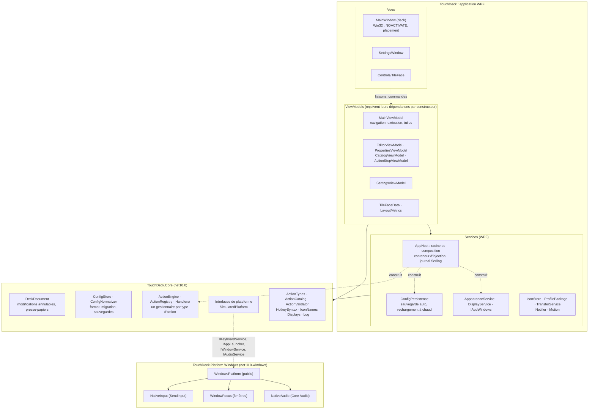
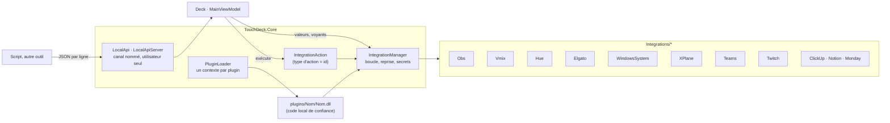
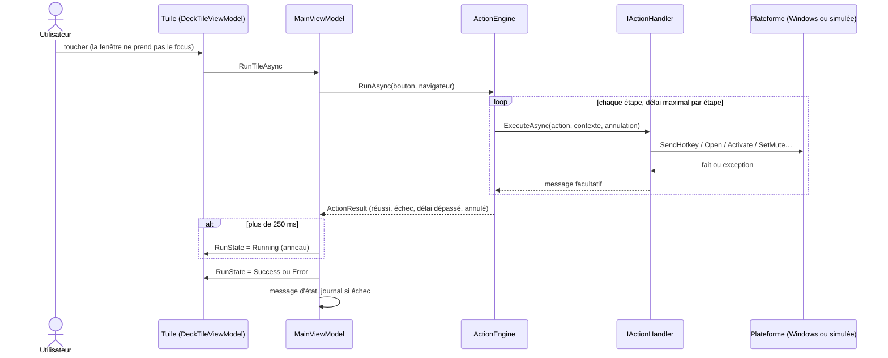
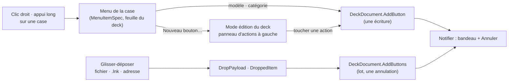

# Architecture

TouchDeck est une application **WPF / .NET 10**, en MVVM avec CommunityToolkit.Mvvm et WPF-UI (lepoco, licence MIT). Elle est
composée de **trois projets**, dont les frontières sont vérifiées par les tests (`ArchitectureTests`) :

| Projet | Cible | Contenu | Connaît |
|---|---|---|---|
| `Core/` (`TouchDeck.Core`) | `net10.0` | Modèle, document annulable, configuration, moteur d'actions, interfaces de plateforme, journal (façade) | Rien d'autre : ni WPF, ni Windows, ni les autres projets |
| `Platform/Windows/` (`TouchDeck.Platform.Windows`) | `net10.0-windows`, sans WPF | `SendInput`, fenêtres Win32, Core Audio (COM), registre. Seul `WindowsPlatform` (et `AutoStart`) est public | Core |
| `Integrations/<Nom>/` (un projet par connecteur) | `net10.0` (`net10.0-windows10.0.19041.0` pour le système Windows) | Un logiciel ou service piloté : commandes, valeurs d'état, connexion | Core |
| racine (`TouchDeck`) | `net10.0-windows10.0.19041.0`, WPF | Fenêtres, ViewModels, services, composition (`AppHost`), API locale côté interface | Core, plateforme Windows et connecteurs |

Les P/Invoke et le COM ne vivent que dans `Platform/Windows/` (internes) et `MainWindow.xaml.cs` (placement de la fenêtre).

## Composition et injection de dépendances

`AppHost.Build` est la racine de composition : elle construit un conteneur `Microsoft.Extensions.DependencyInjection` et
branche le journal Serilog. Les tests construisent **le même conteneur** en simulation, sur un dossier temporaire.

| Service | Rôle |
|---|---|
| `StartupResult`, `DeckDocument` | Configuration chargée au démarrage (fichier invalide mis de côté) et document unique |
| `PlatformServices` | Clavier, lancement, fenêtres, audio : Windows, ou simulés avec `--simulate` |
| `ActionRegistry`, `ActionEngine` | Un `IActionHandler` du conteneur par type d'action ; le moteur exécute les étapes |
| `ConfigPersistence` | Sauvegarde 300 ms après la dernière modification, rechargement à chaud de `config.json` |
| `AppearanceService` | Thème, animations et style des icônes, appliqués à chaque changement des réglages |
| `DisplayService` | Écrans et écran cible du deck (la source `IDisplayService` est injectée) |
| `IAppWindows` | Éditeur et paramètres, une instance de chacun |
| `GridState`, `AppOptions` | Grille automatique du deck ; options de la ligne de commande |

Les fenêtres reçoivent l'`IServiceProvider` et construisent leur ViewModel avec elles-mêmes comme « shell »
(`ActivatorUtilities.CreateInstance`), car le ViewModel demande à la fenêtre ses boîtes de dialogue.

Restent statiques, par nature : `Notifier` (bus de messages), `Theme` et `Motion` (ressources globales de l'application
WPF), `ConfigStore` et `IconStore` (fichiers du dossier de configuration) et la façade `Log`. Aucune ne porte d'état
métier.

Libérer le conteneur (`App.OnExit`) enregistre les modifications en attente, arrête la surveillance de `config.json` et
interrompt les actions en cours.
## Intégrations, plugins et API locale

`IIntegration` (Core) décrit un connecteur : réglages, commandes, état de connexion, valeurs lisibles. `IntegrationManager` fait
vivre une boucle par intégration activée (connexion avec délai, reprise après 2, 4… 60 s, redémarrage si les réglages changent).
Une étape de bouton `{ Type = <id>, Value = <commande>, Args = <argument> }` est relayée par un gestionnaire générique,
`IntegrationAction`, sans nouveau format d'action (ADR 0011).

Les valeurs publiées (`obs.scene`, `sys.cpu`) alimentent les titres `{obs.scene:repli}` et les voyants des touches ; seule la
tuile concernée est redessinée. Les secrets passent par `ISecretStore` (DPAPI), jamais par `config.json`. Les plugins et l'API
locale sont décrits dans `docs/plugins.md` et `docs/local-api.md` (ADR 0012).

## Responsabilités

| Domaine | Où | Notes |
|---|---|---|
| Modèle des profils | `Core/Models.cs` | `DeckConfig` › `Profiles` › `Pages` › `Buttons` (› `Children` pour les dossiers) › `Actions`. |
| Modifications | `Core/DeckDocument.cs` | Toute modification de contenu passe par lui (historique 100 niveaux, presse-papiers interne). |
| Persistance et migrations | `Core/ConfigStore.cs`, `Core/ConfigNormalizer.cs` | Écriture atomique (fichier temporaire + `File.Replace`), 15 sauvegardes, migration v1 → v2, réparation sans perte. |
| Moteur d'actions | `Core/Actions/ActionEngine.cs` | Séquence d'étapes, délai maximal par étape, annulation (`CancellationToken`, `CancelAll` à l'arrêt), résultat typé (`ActionResult`). |
| Types d'action | `Core/Actions/Handlers/` | Une classe par type (`HotkeyAction`, `HttpAction`…) sur trois bases : synchrone, hors thread d'interface avec délai maximal, libre. L'identifiant est la clé stable de `config.json`. `ActionRegistry` refuse les doublons. |
| Intégrations système | `Core/Actions/Platform.cs` → `Platform/Windows/` | `IKeyboardService`, `IAppLauncher`, `IWindowService`, `IAudioService`. Les ViewModels et le moteur n'appellent jamais Win32 : le compilateur l'interdit (types internes). |
| Écrans | `Core/Displays.cs`, `Services/DisplayService.cs` | `DisplayResolver` (logique pure, testée) choisit l'écran ; `IDisplayService` fournit les écrans et signale les changements. Placement en pixels physiques dans `MainWindow.xaml.cs` (`SetWindowPos`). |
| Rendu des touches | `ViewModels/TileFaceData.cs`, `Controls/TileFace` | Le modèle ne connaît pas le rendu ; la variante (standard, média, navigation, affichage, image) est déduite du contenu. |
| Thème | `Theme.cs` | Palettes claire / sombre (contrastes testés), brushes `Deck*` publiées en `DynamicResource`, corps teinté des touches. |
| Identifiants du format | `Core/ActionTypes.cs` | `ActionTypes`, `PageTargets`, `AudioCommands` : clés stables de `config.json`, figées par un test. |
| Journal | `Core/Log.cs`, `Services/AppHost.cs` | Façade `Log` (Core) branchée sur Serilog ; `ILogger<T>` dans les services injectés. `touchdeck.log` (1 Mo, 3 fichiers) : démarrage, erreurs, échecs d'action, changements d'écran. |
| Notifications | `Services/Notifier.cs` | Toast de l'éditeur, message du deck (avec bouton *Annuler* ou *Modifier*). |
| Création rapide | `Core/QuickCreate.cs`, `ViewModels/MainViewModel.TileMenu.cs`, `ViewModels/DeckDialogViewModel.cs` | Modèles, classement des suggestions, menu des cases, panneau de saisie. Une écriture = `DeckDocument.AddButton(s)` (ADR 0014). |
| Glisser-déposer | `Core/DroppedItem.cs`, `Services/DropPayload.cs`, `MainWindow.Drop.cs`, `ViewModels/MainViewModel.Drop.cs` | Classe un chemin ou une adresse (Core, pur), lit l'objet OLE et l'icône (application), crée les boutons dans les cases libres. |

## Exécution d'un bouton

1. `DeckTileViewModel.Click` → `MainViewModel.RunTileAsync` (thread d'interface).
2. `ActionEngine.RunAsync(bouton, navigateur)` copie la liste d'étapes et les exécute dans l'ordre :
   - les étapes rapides (clavier, navigation) tournent sur place ;
   - le lancement de programmes passe sur le pool de threads, avec délai maximal ;
   - les requêtes HTTP sont asynchrones ;
   - les pauses et minuteurs sont annulables.
3. Si l'exécution dure plus de 250 ms, la tuile affiche un anneau. Le résultat s'affiche ensuite (coche ou alerte) et le message éventuel apparaît en toast. Les échecs sont journalisés.
4. Seule la tuile concernée change (`Face`, `RunState`) : la grille n'est pas reconstruite.

## Mise à jour de la grille du deck

`MainViewModel.BuildTiles` réconcilie les cases une à une. L'identité d'une case est formée par :
- son type (bouton, case vide, case « + », case « retour ») ;
- son emplacement et son index ;
- l'instance du bouton, son titre, le fait d'être un dossier ;
- le mode édition.

Tant que cette identité ne change pas, la tuile existante est gardée et seule sa face est recalculée. Une modification
faite dans l'éditeur ne régénère donc que les cases touchées. Mesure hors écran, 32 touches : 135 ms → 12 ms par
modification. Un changement de thème recrée toutes les tuiles.

## Création rapide d'un bouton

Le menu est décrit en `MenuItemSpec` par `MainViewModel.BuildTileMenu` ; la feuille du deck l'affiche (un `ContextMenu` WPF
sortirait du traitement tactile du deck, ADR 0013). Un modèle qui demande un réglage ouvre l'éditeur rapide sur la case ;
sinon le bouton est créé tout de suite. Les suggestions viennent de `ActionCatalog` (actions natives, applications cibles,
intégrations) classées par `QuickCreate.Rank`.

## Édition intégrée au deck

En mode édition, `MainViewModel` crée un `EditorViewModel` (fabrique injectée `Func<IEditorShell, EditorViewModel>`) et le libère à la sortie.
`MainWindow` sert de « shell » (dialogues, focus) et affiche `CatalogPanel` (gauche) et `PropertiesPanel` (droite) autour de la grille ;
les ressources des panneaux sont dans `Themes/EditorShared.xaml`, partagées avec l'éditeur séparé. La grille garde ses colonnes et lignes
(`LayoutMetrics.GridSize` sur la taille complète) et rétrécit. `MainWindow.SetEditing` retire `WS_EX_NOACTIVATE` et suspend le filtre
d'activation et du toucher pendant l'édition, puis les rétablit et rend le focus (ADR 0015).

## Thème

`Core/MaterialColor.cs` calcule des palettes tonales (clarté CIELAB, chroma réduite au gamut sRGB) et `MaterialScheme` en tire les rôles
Material Design 3. `Theme.Build` les associe aux couleurs nommées (`DeckPanel`, `DeckAccent`, `DeckOnAccent`…) publiées en `DynamicResource`.

## Configuration et modèle de données

Le format de `config.json`, son cycle de vie (chargement, migration, sauvegarde atomique, rechargement à chaud) et le
modèle de données sont décrits dans [configuration.md](configuration.md).

## Décisions d'architecture

Elles sont consignées dans [adr/](adr/README.md).

## Choix du framework : WPF conservé

| Critère | WPF (actuel) | Avalonia | WinUI 3 |
|---|---|---|---|
| Fenêtre sans focus (`WS_EX_NOACTIVATE`), cœur du produit | Maîtrisé, testé | Possible par HWND natif, à refaire | Possible, plus contraint |
| Linux | Non | Oui (X11 ; Wayland partiel) | Non |
| Qualité visuelle atteignable | Suffisante : la refonte le montre (styles, ombres, transitions) | Équivalente | Équivalente |
| Coût de migration | Nul | Réécrire toutes les vues, styles, harnais de tests UI | Réécriture + empaquetage |

**Décision** : garder WPF. Les limites visuelles venaient de l'implémentation, pas du framework.
La logique métier (`Core/`) est déjà indépendante de WPF et de Win32, si bien qu'une interface Avalonia pourra s'y brancher plus tard, sans toucher au moteur ni aux données.

## Préparation de Linux

Le Core est un projet `net10.0` indépendant de Windows et de WPF (`ArchitectureTests`). Il reste à faire, dans l'ordre :

1. Adaptateurs Linux, par service :

   | Service | X11 | Wayland |
   |---|---|---|
   | `IKeyboardService` | XTest | Dépend du compositeur (`wtype`, `ydotool`) |
   | `IAppLauncher` | `xdg-open` | `xdg-open` |
   | `IWindowService` | EWMH (`_NET_ACTIVE_WINDOW`) | Souvent impossible : à déclarer non pris en charge |
   | `IAudioService` | PulseAudio / PipeWire (`pactl`) | PulseAudio / PipeWire (`pactl`) |
   | `IDisplayService` | XRandR | Selon le compositeur |

2. Sortir `DeckDocument`, `ConfigPersistence` et la logique des ViewModels qui n'ont pas de types WPF dans un projet partagé.
   `TileFaceData` utilise des `Brush` WPF : à remplacer par des couleurs neutres.
3. Front Avalonia réutilisant ces ViewModels.

Aucune fonction n'est déclarée multiplateforme tant qu'elle n'a pas été testée sous Linux.