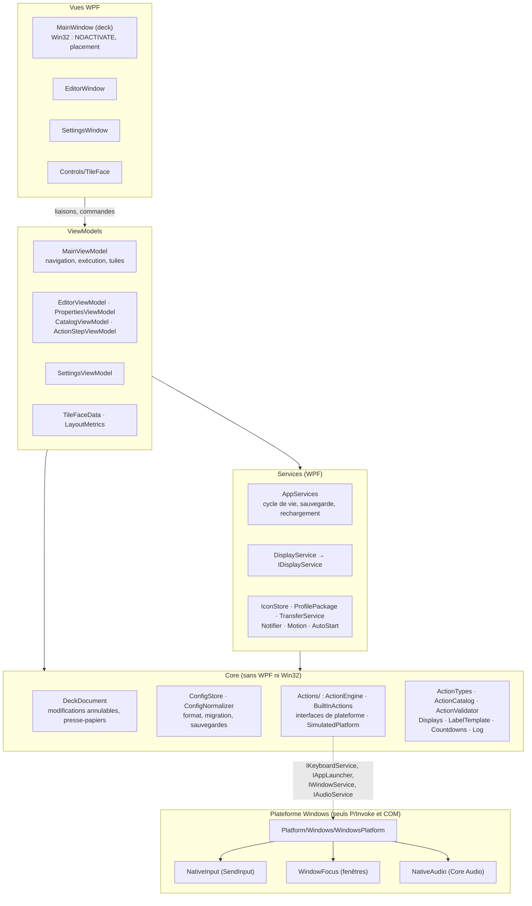
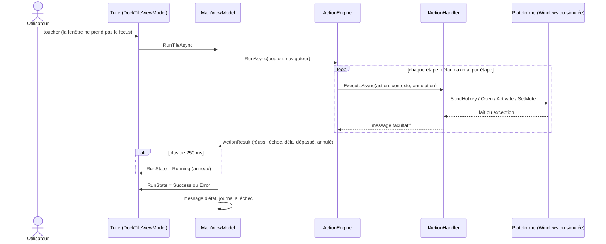

# Architecture

TouchDeck est une application **WPF / .NET 9** (`net9.0-windows`), en MVVM avec CommunityToolkit.Mvvm et WPF-UI (lepoco, licence MIT).
Un seul assembly, organisé en couches par dossier.

Les P/Invoke et le COM ne vivent que dans `NativeInput.cs`, `WindowFocus.cs`, `NativeAudio.cs` et `MainWindow.xaml.cs`.

## Responsabilités

| Domaine | Où | Notes |
|---|---|---|
| Modèle des profils | `Models.cs` | `DeckConfig` › `Profiles` › `Pages` › `Buttons` (› `Children` pour les dossiers) › `Actions`. |
| Modifications | `Core/DeckDocument.cs` | Toute modification de contenu passe par lui (historique 100 niveaux, presse-papiers interne). |
| Persistance et migrations | `Core/ConfigStore.cs`, `Core/ConfigNormalizer.cs` | Écriture atomique (fichier temporaire + `File.Replace`), 15 sauvegardes, migration v1 → v2, réparation sans perte. |
| Moteur d'actions | `Core/Actions/ActionEngine.cs` | Séquence d'étapes, délai maximal par étape, annulation (`CancellationToken`, `CancelAll` à l'arrêt), résultat typé (`ActionResult`). |
| Types d'action | `Core/Actions/BuiltInActions.cs` | Un `IActionHandler` par type ; l'identifiant (`hotkey`, `http`…) est la clé stable de `config.json`. |
| Intégrations système | `Core/Actions/Platform.cs` → `Platform/Windows/` | `IKeyboardService`, `IAppLauncher`, `IWindowService`, `IAudioService`. Les ViewModels et le moteur n'appellent jamais Win32. |
| Écrans | `Core/Displays.cs`, `Services/DisplayService.cs` | `DisplayResolver` (logique pure, testée) choisit l'écran ; `IDisplayService` fournit les écrans et signale les changements. Placement en pixels physiques dans `MainWindow.xaml.cs` (`SetWindowPos`). |
| Rendu des touches | `ViewModels/TileFaceData.cs`, `Controls/TileFace` | Le modèle ne connaît pas le rendu ; la variante (standard, média, navigation, affichage, image) est déduite du contenu. |
| Thème | `Theme.cs` | Palettes claire / sombre (contrastes testés), brushes `Deck*` publiées en `DynamicResource`, corps teinté des touches. |
| Identifiants du format | `Core/ActionTypes.cs` | `ActionTypes`, `PageTargets`, `AudioCommands` : clés stables de `config.json`, figées par un test. |
| Journal | `Core/Log.cs` | `touchdeck.log` (1 Mo, puis `.old`) : démarrage, erreurs, échecs d'action, changements d'écran. Dans `Core` pour que la persistance puisse journaliser. |
| Notifications | `Services/Notifier.cs` | Toast de l'éditeur, message du deck. |

## Exécution d'un bouton

1. `DeckTileViewModel.Click` → `MainViewModel.RunTileAsync` (thread d'interface).
2. `ActionEngine.RunAsync(bouton, navigateur)` copie la liste d'étapes et les exécute dans l'ordre :
   - les étapes rapides (clavier, navigation) tournent sur place ;
   - le lancement de programmes passe sur le pool de threads, avec délai maximal ;
   - les requêtes HTTP sont asynchrones ;
   - les pauses et minuteurs sont annulables.
3. Si l'exécution dure plus de 250 ms, la tuile affiche un anneau. Le résultat s'affiche ensuite (coche ou alerte) et le message éventuel apparaît en toast. Les échecs sont journalisés.
4. Seule la tuile concernée change (`Face`, `RunState`) : la grille n'est pas reconstruite.

## Mise à jour de la grille du deck

`MainViewModel.BuildTiles` réconcilie les cases une à une. L'identité d'une case est formée par :
- son type (bouton, case vide, case « + », case « retour ») ;
- son emplacement et son index ;
- l'instance du bouton, son titre, le fait d'être un dossier ;
- le mode édition.

Tant que cette identité ne change pas, la tuile existante est gardée et seule sa face est recalculée. Une modification
faite dans l'éditeur ne régénère donc que les cases touchées. Mesure hors écran, 32 touches : 135 ms → 12 ms par
modification. Un changement de thème recrée toutes les tuiles.

## Configuration et modèle de données

Le format de `config.json`, son cycle de vie (chargement, migration, sauvegarde atomique, rechargement à chaud) et le
modèle de données sont décrits dans [configuration.md](configuration.md).

## Décisions d'architecture

Elles sont consignées dans [adr/](adr/README.md).

## Choix du framework : WPF conservé

| Critère | WPF (actuel) | Avalonia | WinUI 3 |
|---|---|---|---|
| Fenêtre sans focus (`WS_EX_NOACTIVATE`), cœur du produit | Maîtrisé, testé | Possible par HWND natif, à refaire | Possible, plus contraint |
| Linux | Non | Oui (X11 ; Wayland partiel) | Non |
| Qualité visuelle atteignable | Suffisante : la refonte le montre (styles, ombres, transitions) | Équivalente | Équivalente |
| Coût de migration | Nul | Réécrire toutes les vues, styles, harnais de tests UI | Réécriture + empaquetage |

**Décision** : garder WPF. Les limites visuelles venaient de l'implémentation, pas du framework.
La logique métier (`Core/`) est déjà indépendante de WPF et de Win32, si bien qu'une interface Avalonia pourra s'y brancher plus tard, sans toucher au moteur ni aux données.

## Préparation de Linux

Il reste à faire, dans l'ordre :

1. Extraire `Core/` et `Models.cs` dans un projet `TouchDeck.Core` (`net9.0`). Les dépendances à lever d'abord :
   - `ActionValidator` appelle `NativeInput.TryValidateHotkey` (validation à déplacer derrière `IKeyboardService`) ;
   - `ConfigNormalizer` lit `Theme.DefaultBackground` (constante à déplacer) ;
   - `ActionValidator` appelle `IconStore.Resolve`.
2. Adaptateurs Linux, par service :

   | Service | X11 | Wayland |
   |---|---|---|
   | `IKeyboardService` | XTest | Dépend du compositeur (`wtype`, `ydotool`) |
   | `IAppLauncher` | `xdg-open` | `xdg-open` |
   | `IWindowService` | EWMH (`_NET_ACTIVE_WINDOW`) | Souvent impossible : à déclarer non pris en charge |
   | `IAudioService` | PulseAudio / PipeWire (`pactl`) | PulseAudio / PipeWire (`pactl`) |
   | `IDisplayService` | XRandR | Selon le compositeur |

3. Front Avalonia réutilisant les ViewModels qui n'ont pas de types WPF. `TileFaceData` utilise des `Brush` WPF : à remplacer par des couleurs neutres.

Aucune fonction n'est déclarée multiplateforme tant qu'elle n'a pas été testée sous Linux.
