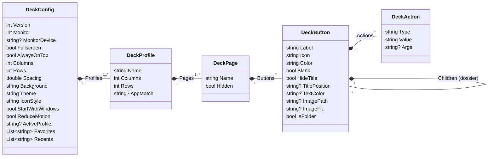
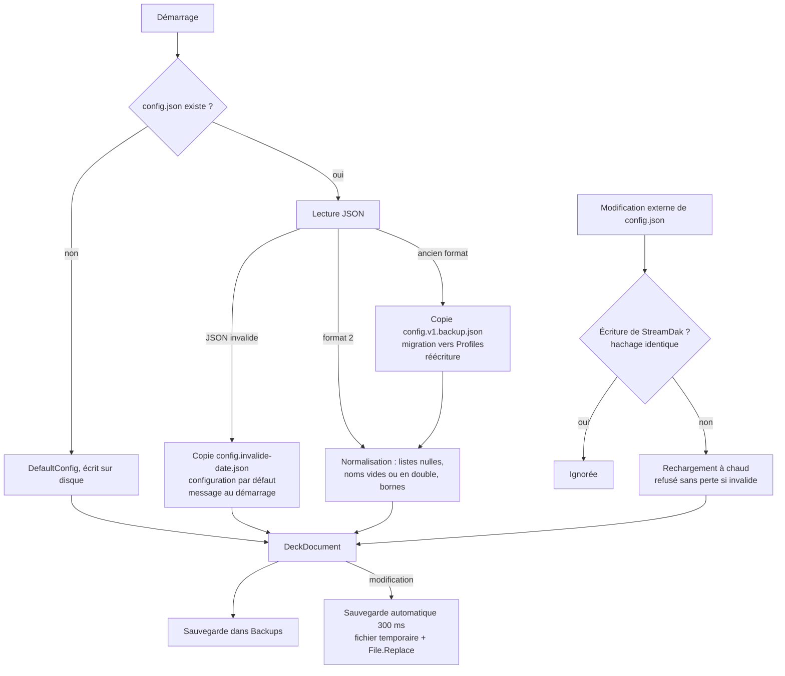

# Format de configuration

StreamDak enregistre tout dans un seul fichier JSON, `config.json`. Il est lisible et modifiable à la main : toute
modification enregistrée est appliquée sans redémarrer (rechargement à chaud).

- **Dossier** : `%APPDATA%\StreamDak`, ou celui de la variable d'environnement `STREAMDAK_DATA_DIR` (essais). Un ancien dossier
  `%APPDATA%\TouchDeck` est déplacé vers le nouveau au premier lancement (ADR 0018) ; l'ancienne variable `TOUCHDECK_DATA_DIR` reste acceptée.
- **Version du format** : `2` (`ConfigNormalizer.CurrentVersion`).
- **Code** :
  - modèle : `Models.cs` ;
  - lecture et écriture : `Core/ConfigStore.cs` ;
  - migration et réparation : `Core/ConfigNormalizer.cs`.

## Fichiers du dossier

| Élément | Rôle |
|---|---|
| `config.json` | Configuration. Créée au premier lancement (`ConfigStore.DefaultConfig`). |
| `Icons\` | Images importées, en PNG, nommées par le hachage de leur contenu (`IconStore`). Aucun autre nom n'est jamais lu. |
| `Backups\config-<date>-<n>.json` | Sauvegardes : au démarrage, avant un import ou une restauration, et à la demande (Paramètres). Une sauvegarde identique à la précédente n'est pas recréée. Les 15 dernières sont conservées. |
| `config.v1.backup.json` | Copie intacte d'un fichier de l'ancien format, faite une seule fois avant la migration. |
| `config.invalide-<date>.json` | Copie d'un `config.json` illisible au démarrage, conservée avant toute réécriture. |
| `streamdak.log` | Journal de diagnostic (Serilog) : démarrage, erreurs, actions en échec, changements d'écran. Au-delà de 1 Mo, un nouveau fichier est ouvert (`streamdak_001.log`…) ; les 3 derniers sont conservés. |

## Structure



### Racine (`DeckConfig`)

| Clé | Type | Défaut | Rôle |
|---|---|---|---|
| `Version` | entier | `2` | Version du format. Absente ou `1` : ancien format, migré au chargement. |
| `Monitor` | entier | `-1` | Index de l'écran du deck ; `-1` = premier écran secondaire, sinon l'écran principal. |
| `MonitorDevice` | texte | absent | Identifiant Windows de l'écran (`\\.\DISPLAY2`). Il prime sur `Monitor`, dont l'index change quand on rebranche un écran. |
| `Fullscreen` | booléen | `true` | Plein écran sur la zone de travail de l'écran cible (la barre des tâches reste visible). |
| `AlwaysOnTop` | booléen | `false` | Le deck reste au-dessus des autres fenêtres. |
| `Columns`, `Rows` | entiers | `0` | Grille des profils en format automatique ; `0` = selon la résolution. Bornés de 0 à 20. |
| `Spacing` | nombre | `14` | Espacement entre les touches, en DIP. Borné de 0 à 80. |
| `Background` | couleur | `#0E1015` | Fond du deck. La valeur par défaut affiche le fond nuancé du thème ; une autre couleur donne un fond uni. |
| `Theme` | texte | `system` | `system` (suit Windows), `dark`, `amoled` (sombre à fond noir) ou `light`. Une nouvelle configuration est créée en `dark`. |
| `IconStyle` | texte | `fluent` | `fluent` : les emojis connus s'affichent en icônes Fluent ; `emoji` : tels quels. |
| `StartWithWindows` | booléen | | Reflet du lancement à l'ouverture de session. C'est la clé Run du registre qui fait foi. |
| `ReduceMotion` | booléen | `false` | Supprime les animations, en plus du réglage de Windows. |
| `ActiveProfile` | texte | premier profil | Profil affiché sur le deck. |
| `Favorites`, `Recents` | listes | `[]` | Identifiants d'actions du catalogue. Les récents sont limités à 12. |
| `Profiles` | liste | | Profils, au moins un après normalisation. |

### Profil (`DeckProfile`)

| Clé | Défaut | Rôle |
|---|---|---|
| `Name` | `Profil` | Nom unique, sans distinction de casse ; visé par les actions `profile`. |
| `Columns`, `Rows` | absents (`0`) | Format de grille du profil ; `0` = réglage global. |
| `AppMatch` | absent | Nom d'un programme (`chrome`). Le profil s'affiche quand ce programme est au premier plan. Un programme ne déclenche qu'un seul profil. |
| `Pages` | | Pages, au moins une. |

### Page (`DeckPage`)

| Clé | Défaut | Rôle |
|---|---|---|
| `Name` | `Page` | Nom unique dans le profil ; visé par les actions `page`. |
| `Hidden` | `false` | Page absente des onglets du deck, mais accessible par une action `page`. |
| `Buttons` | `[]` | Cases dans l'ordre de la grille, de gauche à droite puis de haut en bas. |
| `Kind` | absent | `web` : la page affiche `Url` sur tout l'espace central, sans grille (les `Buttons` sont conservés, masqués). Absent ou inconnu : grille de boutons. |
| `Url` | absent | Adresse `http` ou `https` d'une page `web`. Ignorée pour une grille. |
| `Zoom` | absent (`100 %`) | Zoom d'une page `web`, en % (25 à 500). Absent à 100 %. |

### Bouton (`DeckButton`)

| Clé | Défaut | Rôle |
|---|---|---|
| `Label` | `""` | Titre. Peut contenir des modèles : `{time}`, `{date}`, `{time:HH:mm:ss}`, `{date:dddd d MMMM}`, `{timer}`. |
| `Icon` | `""` | Nom d'icône Fluent (`Play24`), emoji ou texte court. |
| `Color` | `#334155` | Couleur du bouton : pastille pleine et corps teinté de la touche. |
| `Actions` | `[]` | Étapes exécutées dans l'ordre. Un bouton sans action dont le titre contient `{time}` ou `{date}` sert d'horloge. |
| `Blank` | absent | Case vide qui garde la position de ses voisines. |
| `HideTitle` | absent | Masque le titre. |
| `TitlePosition` | absent | `top`, `middle` ou `bottom` : titre superposé. Absent : titre sous l'icône. |
| `TextColor` | absent | Couleur du texte et de l'icône (défaut : blanc). |
| `ImagePath` | absent | Nom d'une image du dossier `Icons\` (hachage + `.png`). |
| `ImageFit` | absent | `cover` (remplit la touche, défaut) ou `contain` (image entière). |
| `IsFolder`, `Children` | absents | Dossier et son contenu, sur 8 niveaux au maximum. |
| `Widget` | absent | `clock`, `agenda`, `web`, `cpu` ou `ram` : le bouton est un widget (affichage, pas d'action). Identifiant inconnu : ignoré. |
| `WidgetOptions` | absent | Réglages du widget : `seconds`, `hour12`, `date` (horloge), `count`, `days` (agenda), `url` (page web, http ou https), `zoom` (page web, 25 à 500), `source` (niveau audio : `sonar:game`, `windows:capture:Focusrite`), `shape` (niveau audio : `vertical` ou `horizontal`, absent = roue). |
| `ColSpan`, `RowSpan` | absents (une case) | Largeur et hauteur d'un widget en cases (1 à 8). Les cases recouvertes doivent être vides. |

Les clés marquées « absent » ne sont écrites que si elles ont une valeur (`JsonIgnore(WhenWritingDefault/Null)`) : le
fichier reste léger et lisible.

### Étape (`DeckAction`)

`Type` est une clé stable : l'une des valeurs de `ActionTypes` (`Core/ActionTypes.cs`). Le tableau des types, avec le
sens de `Value` et `Args`, est dans le [README](../README.md#types-dactions).

## Cycle de vie



- **Écriture atomique** : le JSON est écrit dans `config.json.tmp`, puis substitué par `File.Replace`. Un arrêt pendant
  l'écriture laisse l'ancien fichier intact.
- **Nos propres écritures** sont reconnues par le hachage du contenu : le surveillant de fichier ne recharge pas ce que
  StreamDak vient d'écrire.
- **Un fichier invalide n'est jamais écrasé** sans en garder une copie.

## Migrations

| De | Vers | Ce qui change |
|---|---|---|
| Sans `Version` ou `1` (`Pages` à la racine) | `2` | `Pages` devient le profil « Principal » dans `Profiles`. Aucune autre clé n'est renommée ni supprimée. Copie intacte dans `config.v1.backup.json`. |

Réparations faites à chaque chargement, sans rien supprimer de valide :
- les listes nulles deviennent vides ;
- un profil ou une page sans nom reçoit « Profil n » ou « Page n » ;
- les noms en double sont rendus uniques ;
- les grilles et l'espacement sont bornés ;
- un thème inconnu devient `system` ;
- le profil actif est rattaché à un profil existant ;
- une position de titre ou un ajustement d'image inconnu est retiré ;
- un dossier plus profond que 8 niveaux est vidé dans le dernier dossier autorisé.

Les noms rendus uniques et les dossiers ignorés produisent un avertissement ; le premier est affiché au démarrage.
Les autres réparations sont silencieuses.

> **Dossiers trop profonds** : au-delà du 8ᵉ niveau d'imbrication, le contenu est remonté à la fin du dernier dossier
> autorisé (les boutons existants gardent leur position, les dossiers excédentaires sont vidés), avec un avertissement.
> Aucun bouton n'est supprimé. L'éditeur ne permet pas de créer une telle profondeur ; le cas ne concerne qu'un fichier
> modifié à la main.

## Faire évoluer le format

Règles du dépôt (voir `AGENTS.md`) :

1. Toute nouvelle clé a une valeur par défaut et `JsonIgnore(WhenWritingDefault/Null)` : un ancien fichier reste lisible
   et un nouveau fichier ne s'alourdit pas.
2. Aucune clé n'est renommée ni supprimée sans migration dans `ConfigNormalizer` et sans test dans `ConfigStoreTests`.
3. Un changement de format est validé avec le mainteneur avant d'être codé. On incrémente alors `CurrentVersion` et on
   ajoute une ligne au tableau des migrations ci-dessus.
4. Les valeurs de `ActionTypes`, `PageTargets` et `AudioCommands` sont figées par `FormatKeysTests`.

## Exemple minimal

```json
{
  "Version": 2,
  "Theme": "dark",
  "ActiveProfile": "Principal",
  "Profiles": [
    {
      "Name": "Principal",
      "Columns": 5,
      "Rows": 3,
      "Pages": [
        {
          "Name": "Accueil",
          "Buttons": [
            { "Label": "Copier", "Icon": "Copy24", "Color": "#334155",
              "Actions": [ { "Type": "hotkey", "Value": "ctrl+c" } ] },
            { "Label": "{time}", "Icon": "Clock24", "Color": "#334155", "Actions": [] },
            { "Blank": true },
            { "Label": "Réunion", "Icon": "Video24", "Color": "#7C3AED",
              "Actions": [
                { "Type": "focus", "Value": "Teams", "Args": "ms-teams.exe" },
                { "Type": "delay", "Value": "150" },
                { "Type": "hotkey", "Value": "ctrl+shift+m" }
              ] }
          ]
        }
      ]
    }
  ]
}
```

Les clés absentes prennent leur valeur par défaut. Les clés inconnues sont ignorées à la lecture.
